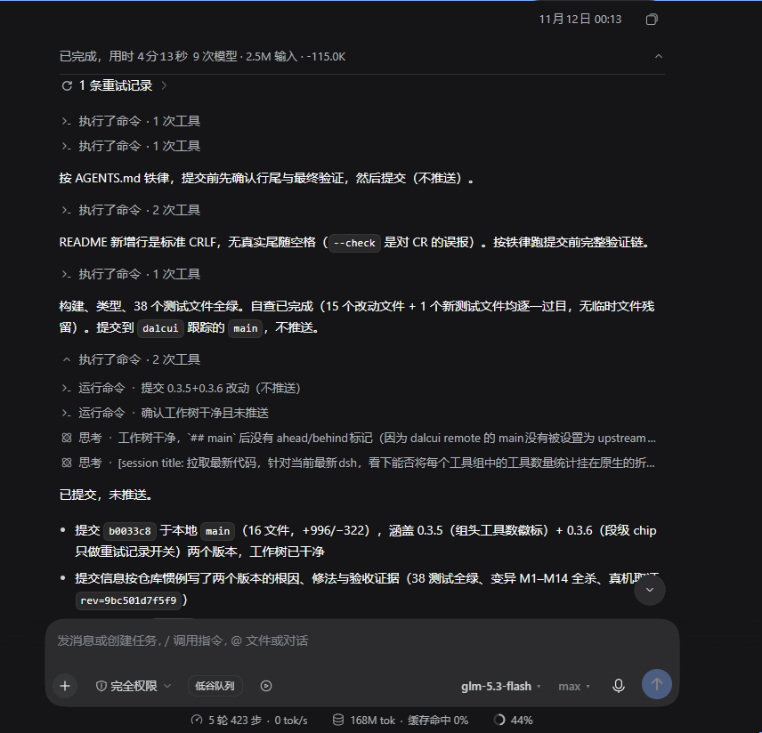

# dsh-auto-collapse

> A DeepSeek Harness Web client plugin that auto-collapses tool cards and Think blocks into one-line summaries. Enhanced with per-turn metrics bar (duration / token usage / tok/s, configurable), interaction awareness, state persistence, accessibility labels, and i18n — all without dsh-harmony dependency.
>
> **Core principle: the whole execution process is shown hierarchically and quantitatively.** Every piece of non-body system info (reasoning / tool calls / context injections / retry status rows) folds into expandable rows labeled with `category × count`, while the latest in-flight activity stays visible.
>
> Behavior spec (arbiter for "feature vs bug" boundary behavior, in Chinese): [behavior-spec.md](./behavior-spec.md) · 中文: [README.md](./README.md)
> This is a thin entry point: full feature details → [docs/features.en.md](docs/features.en.md); host-version adaptation history → [docs/adaptation-history.md](docs/adaptation-history.md) (Chinese); module map & data flow → [docs/architecture.md](docs/architecture.md) (Chinese); deploy / publish / hot-update mechanics → [docs/how-to.md](docs/how-to.md).

## What it does

`dsh-auto-collapse` is a pure front-end DOM plugin for the DeepSeek Harness Web chat UI. It collapses the working process into one-line summaries — tool calls and reasoning no longer fill the screen, giving the chat the collapsible look of the VSCode Codex desktop client, **and it also rewrites "Deep diving" to a configurable "Deep sleeping..."**. It never modifies message content — it only controls visibility of the working process.

## Preview



## Features (quick list)

Full semantics (counting rules, edge behaviors, settings) in [docs/features.en.md](docs/features.en.md).

- **Turn-level auto collapse** (level 1): a finished turn folds into a single `processed in Xs` row; click to expand the full workflow.
- **Live in-progress summary bar**: ticking `worked for Xs | tool calls / tokens…` row with a pulsing indicator; never blocks streaming output.
- **Second-level chips**: tool groups / think blocks collapse into `category × count` rows (e.g. `2 reasoning steps · Bash ×2 · 1 retry`); only 2+ adjacent non-body items fold.
- **Per-group tool counts** (native compact mode): each official tool-group title ends with `· N tool calls`; `run_code` counts parsed sub-tools.
- **Segment chip = retry log only**: appears only when block-external retry/status rows exist (`N retry records`) and toggles just those rows.
- **PTC sub-tool names**: a `Code` card orchestrating multiple tools shows real sub-tool names × count (`Bash ×2 · Read ×1`).
- **Trailing tool-call description**: last tool call's description/command/path on completed chips; always / on-hover / never (configurable).
- **Keep last N body steps per turn** (default 1) — the final text stays unfolded; the last turn always keeps ≥1 body message.
- **Native compact-mode integration**: when the host `turn-process` disclosure row exists, the plugin injects metrics into it instead of building its own level-1 row.
- **Per-turn metrics bar**: duration, model/tool calls, input/output/reasoning tokens, cache hit/write & rate, tok/s, TTFT, context delta — configurable fields with custom labels; data reproduced from the React session snapshot via a shadow renderer.
- **Interruption-safe matching**: manual stop → new message, steering, or session switches never cross-contaminate per-turn statistics (main ↔ subagent isolated).
- **Steering (interjection) handling**: while a steering arrives mid-turn, body text stays visible and the metric row stays at the top; official always-open turns are completely untouched.
- **Collapse on abnormal termination**, **main + subagent columns fold independently**, **status-row folding** (retry/failure/limit), **third-level think merge**, **native visual alignment** with 180ms click-driven animations, **stream-friendly reconciliation**.
- **Expand/collapse all**: `Shift+click` a level-1 row toggles that turn's second level; `Ctrl/Cmd+Shift+E` toggles everything globally.
- **Configurable status text** (`Deep sleeping...`; blank restores official `Deep diving...`), **interaction awareness**, **localStorage persistence**, **ARIA labels**, **bilingual labels**.
- **No dsh-harmony dependency; fully reversible** — uninstalling (HMR stop) restores every collapsed/hidden/rewritten node.

## Install

```bash
# Recommended: install from this repository (follows main, includes the latest fixes)
dsh plugin --profile web add "github:Dalcui/dsh-auto-collapse#main"
# Pin a reproducible build to a specific commit / tag
dsh plugin --profile web add "github:Dalcui/dsh-auto-collapse#<commit>"
```

> A package named `dsh-auto-collapse` also exists on npm, but its published version may lag behind this repository. Use the GitHub source above for the latest fixes.

Restart the DSH web service (or trigger plugin HMR), then hard-refresh the page (`Ctrl+Shift+R`). No configuration needed.

Hot enable/disable (roster watchdog, ~1.5–3s auto page reload) and code updates without a service restart (client half via official HMR, host half via server-side hot patching): see [docs/features.en.md](docs/features.en.md#install-related-mechanics-hot-enable--hot-update).

## Compatibility

Works on DSH 0.1.1-rc.x ~ 0.2.2-rc.1 with a single build: the plugin adapts by capability, not by version strings (three-generation settings contract selection, snapshot-shape token fallback, verbatim inject-face forwarding). Adaptation status: **0.2.2-rc.1 done (v0.3.4)**, **0.2.1-rc.2 done (v0.3.0/0.3.1)**, **0.1.7-rc.2 done** — full root-cause/fix/evidence records in [docs/adaptation-history.md](docs/adaptation-history.md) and [DSH_0.1.7_ADAPTATION.md](DSH_0.1.7_ADAPTATION.md) (Chinese).

## Development

```bash
npm run check    # typecheck + build + full regression suite
node test/run-all.mjs   # 38 stub-DOM test files
node build.mjs   # dual artifacts + 4 guards (incl. node --check on the host half)
```

- Module map, data flow, clause↔implementation↔test mapping: [docs/architecture.md](docs/architecture.md) (Chinese).
- Host DOM contract & known pitfalls (read before touching folding): [docs/host-contract.md](docs/host-contract.md) (Chinese).
- Testing, mutation-kill workflow, live verification: [docs/verification.md](docs/verification.md) (Chinese).
- Deploy / publish / hot-update: [docs/how-to.md](docs/how-to.md). Collaboration rules: [AGENTS.md](AGENTS.md). Changelog: [docs/changelog.md](docs/changelog.md).

## License

MIT
