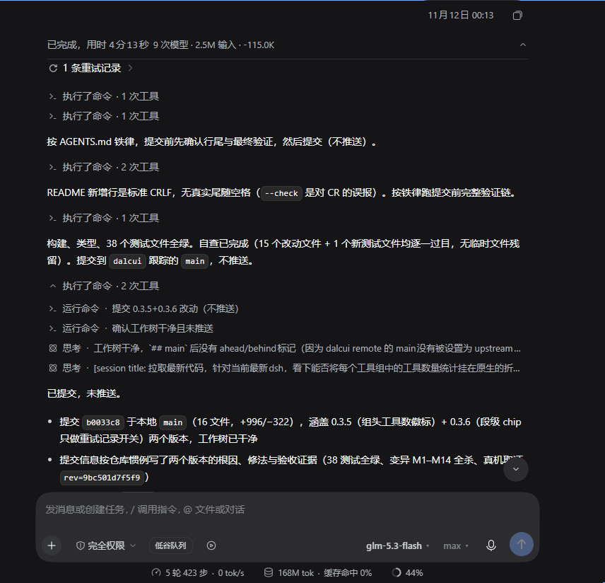

# dsh-auto-collapse

> DeepSeek Harness Web 客户端插件：把会话里的工具卡片与 Think 推理块自动折叠成一行摘要，让界面只保留模型说的话。增强版集成了回合级指标摘要栏（耗时 / token 用量 / tok/s 等，配置可控）。
>
> **核心原则：整个执行过程能分层级、量化地展示。** 模型正文之外的一切系统信息（思考 / 工具调用 / 上下文注入 / 重试等状态行）都按「类别 × 数量」折叠成可展开的行，进行中最新的活动保持可见。
>
> 行为规范（边界行为「特性 or bug」的裁决依据）：[behavior-spec.md](./behavior-spec.md) · English: [README.en.md](./README.en.md)
> 本文是薄入口：特性全文 → [docs/features.md](docs/features.md)；宿主版本适配史 → [docs/adaptation-history.md](docs/adaptation-history.md)；模块地图与数据流 → [docs/architecture.md](docs/architecture.md)；部署/发布/验证细节 → [docs/how-to.md](docs/how-to.md)。

## 这是什么

`dsh-auto-collapse` 是一个纯前端 DOM 插件，挂在 DeepSeek Harness Web 聊天界面上，把工作流程折叠成一行行摘要——工具调用、推理过程不再占据整屏，呈现接近 VSCode Codex 桌面端的折叠体验，**同时将“Deep diving” 修改为可配置的“Deep sleeping...”**。它不改动消息内容，只控制工作流程的显示状态。

## 效果预览



## 特性一览

每条的完整语义（计数口径、边界行为、设置项细节）见 [docs/features.md](docs/features.md)。

- **回合完成自动收起**（一级）：工作过程收成一行 `已处理 X秒`，点击展开完整工作流。
- **进行中实时摘要行**：`已工作 X秒 | 工具调用 / tokens…`，带呼吸点与每秒走表，不打断流式输出。
- **二级折叠 chip**：工具组 / 思考块折叠成一行（`运行了命令` / `已思考` / `上下文注入`…）；正文之间跨类别合并计数（`2 段思考 · Bash ×2 · 1 次重试`）；仅相邻 ≥2 条非正文才折叠；进行中的思考由原生 ReasoningRow 承载。
- **每组工具数**（原生 compact 模式）：官方工具组折叠行末尾直接显示 `· 5 次工具`；`run_code` 按解析出的子工具计数。
- **段级 chip 只管重试记录**：只有存在块外重试 / 状态行时出现（`N 条重试记录`），点击开合这些行。
- **PTC 子工具名展示**：`Code` 卡内编排多工具时折叠行按子工具名 × 数量展示（`Bash ×2 · Read ×1`）。
- **折叠行末尾工具调用说明**：最后一次工具调用的 description / 命令 / 路径，显示方式可配置（始终 / 悬停 / 不显示）。
- **轮次折叠保留最后 N 条正文**：默认 1（只留最终正文），可在设置自定义；最后一轮始终至少留 1 条。
- **原生 compact 模式协同**：检测到宿主 `turn-process` 原生行时不再自建一级行，改为把指标摘要挂进原生行；两套折叠不打架。
- **三级思考合并**：`已思考` 展开后连续思考合并为一个 `Think · 第一句` 行。
- **回合级指标摘要栏**：耗时 / 次模型 / 次工具 / 输入·输出·推理 tokens / 缓存命中·写入 / 命中率 / tok/s / 首 token 用时 / 上下文增量，字段与显示名可在配置；数据经 shadow 渲染器从 React 会话快照按记录复现，精确可靠。
- **中断安全按轮次匹配**：手动停止→新消息、执行中插话、切换会话，各轮次统计互不串扰、计时不归零（main↔subagent 隔离）。
- **分组 = 折叠指标行作用域**：原生行覆盖整回合、自建行覆盖所属段，段级耗时按段切分、回合级数据不摊派，统计结果不重复。
- **插话（steering）工况**：插话进行中正文不隐藏、指标行保持在回合顶部；官方 alwaysOpen 回合插件完全不介入。
- **异常终止也折叠**：手动停止 / 中断 / 超限回合同样生成一级行，追加「已停止 / 已中断」标签。
- **主会话与子代理面板同时折叠**：按列独立服务、独立账本，互不还原。
- **状态行折叠**：原生重试 / 失败 / 超限提示行随段折叠，紧邻工具组的吸收入 chip。
- **原生视觉对齐 + 180ms 过渡动画**：图标盒 / 行高 / 颜色全用 DSH token；仅用户点击触发动画，`prefers-reduced-motion` 下禁用。
- **流式友好**：原地补正文、React 换节点、历史乱序挂载都会重新协调。
- **一键展开/收起**：`Shift+点击` 一级行展开该回合全部二级；`Ctrl/Cmd+Shift+E` 全局展开/收起（含原生行）。
- **可配置状态提示词**：默认 `Deep sleeping...`；留空恢复官方 `Deep diving...`。
- **交互感知 / 状态持久化 / ARIA / 双语**：焦点或选区在活动内容中时保持展开；展开态 localStorage 持久化；`aria-expanded` 齐备；中英文随 DSH 语言设置。
- **不依赖 dsh-harmony；完全可逆**：卸载（HMR stop）完整还原所有折叠 / 隐藏 / 改写。

## 安装

```bash
# 已发布 npm 包（推荐，使用构建好的版本）
dsh plugin --profile web add "dsh-auto-collapse"
# 或从 GitHub 安装（开发版或需要跟随 `main` 分支时）
dsh plugin --profile web add "github:a179-sanae/dsh-auto-collapse#main"
```

安装后重启 DSH web 服务（或触发插件 HMR），页面 `Ctrl+Shift+R` 硬刷新即可生效。无需任何配置。

插件**启停热生效**（roster 看门狗，~1.5–3s 自动刷新页面）与**代码更新无需重启服务**（client 半走官方 client HMR、host 半走服务端热应用）的完整机制与注意事项见 [docs/how-to.md](docs/how-to.md#插件启停与热更新)。

## 兼容性

兼容 DSH 0.1.1-rc.x ~ 0.2.2-rc.1（0.1.2-alpha.x / 0.1.2-rc.1 / 0.1.7-rc.2 / 0.2.0-rc.2 / 0.2.1-rc.2 / 0.2.2-rc.1）。同一份构建产物按宿主能力自适应（设置契约三代选择、token 快照形状回退、inject face 整体透传），不依赖版本字符串分支。

- **0.2.2-rc.1**（v0.3.4）：assistant-step inject face 变更适配 + `data-holding` 运行判据。**已完成**。
- **0.2.1-rc.2**（v0.3.0/0.3.1）：会话流扩展位解包、缓存键一致性、插话工况修复。**已完成**。
- **0.1.7-rc.2**：加载期三代契约 / 折叠不透明容器 / 指标 inject 转发 / 设置保存链路。**已完成**，深度记录见 [DSH_0.1.7_ADAPTATION.md](DSH_0.1.7_ADAPTATION.md)。
- 各版本适配的根因、修法与真机验收全表见 [docs/adaptation-history.md](docs/adaptation-history.md)。

## 开发

```bash
npm run check    # TypeScript 检查 + 构建 + 全部回归测试
npm run build    # esbuild 双产物 + 4 项守卫（node --check / 导出面）
node test/run-all.mjs      # 全量回归（38 个测试文件，桩 DOM）
node deploy.mjs --verify   # 只读校验服务端 bundle 是否已含新字节
```

- 改行为前：符号级模块地图 / client↔host 数据流 / 条款↔实现↔测试三向映射见 [docs/architecture.md](docs/architecture.md)。
- 宿主 DOM 契约与已知坑（改折叠必读）：[docs/host-contract.md](docs/host-contract.md)。
- 测试组织、变异实测模板、真机取证与插话工况构造：[docs/verification.md](docs/verification.md)。
- 本机部署（不重启服务的安全流程）、发布新版本、CHANGELOG 规范：[docs/how-to.md](docs/how-to.md)。
- 版本史：[docs/changelog.md](docs/changelog.md)；协作铁律：[AGENTS.md](AGENTS.md)。

## 许可

MIT
